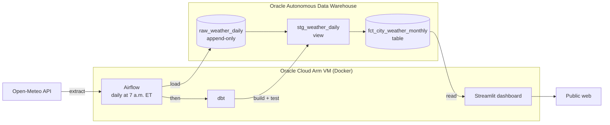

# Daily Weather ELT Pipeline on Oracle Cloud Free Tier

**Live dashboard:** http://129.213.84.91:8501

A production-style ELT pipeline that runs every morning on its own: it pulls daily weather data for five U.S. cities from a public API, lands it raw in Oracle Autonomous Data Warehouse, transforms and tests it with dbt, and serves the results on a public Streamlit dashboard. Everything runs on Oracle Cloud's Always Free tier, so the pipeline costs $0 a month.

## Architecture



## Stack

| Layer | Tool |
| --- | --- |
| Orchestration | Apache Airflow 3 (LocalExecutor), Docker Compose |
| Ingestion | Python, `requests`, `python-oracledb` (thin mode) |
| Warehouse | Oracle Autonomous Data Warehouse (Always Free) |
| Transformation and testing | dbt Core with `dbt-oracle` |
| Presentation | Streamlit |
| Infrastructure | Oracle Cloud Ampere A1 Arm VM, Ubuntu 24.04 |

## How it works

1. **Extract and load.** An Airflow task calls the Open-Meteo API for five cities, requesting the past 7 days on every run. It appends the rows to `raw_weather_daily` with a load timestamp.
2. **Transform.** Once the load succeeds, Airflow runs `dbt build`:
   - `stg_weather_daily` (view) keeps only completed days and the most recent load of each city-day.
   - `fct_city_weather_monthly` (table) aggregates to one row per city per month: average high and low, total precipitation, rainy days.
3. **Test.** dbt tests run as part of every build. A failed test fails the Airflow run.
4. **Serve.** Streamlit queries the warehouse directly, caching results for an hour.

## Design decisions

**ELT, not ETL.** Python does as little as possible: fetch and insert. All business logic lives in version-controlled SQL in dbt, where it is testable and readable by anyone who knows SQL.

**Append-only raw layer, deduplicated downstream.** Recent weather observations get revised after the fact, so every run reloads the last 7 days. The raw table keeps every version it received; the staging model picks the newest per city and date with a window function. Reruns and backfills are safe: running the pipeline twice cannot double-count anything.

**Incomplete data is filtered, not stored as truth.** The API returns today's partial forecast alongside history. Staging drops any row dated on or after its load date, so the marts only ever contain completed days.

**Data quality is enforced, not assumed.** Not-null tests on the keys, plus a custom test that fails if deduplication ever produces more than one row per city-day.

**Retries for transient failures.** Each task retries twice, five minutes apart, so a brief API or network blip doesn't need manual intervention.

**Secure by default.**
- Database connections use TLS, restricted by an IP access list to the VM and my own address.
- Credentials live in an environment file excluded from version control, shared by Airflow, dbt and Streamlit so there is one place to rotate them.
- The Airflow UI is not exposed to the internet; it is reached through an SSH tunnel. Only the dashboard port is open.

**dbt isolated from Airflow.** dbt runs from its own virtual environment inside the Airflow image, so the two tools' dependencies can't conflict on upgrades.

## Repository layout

```
.
├── dags/
│   └── weather_pipeline.py        # Airflow DAG: extract/load task, then dbt build
├── dbt/
│   ├── dbt_project.yml
│   ├── profiles.yml               # reads credentials from environment variables
│   ├── models/
│   │   ├── staging/               # sources, staging view, column tests
│   │   └── marts/                 # monthly fact table
│   └── tests/                     # custom data-quality tests
├── dashboard/
│   └── app.py                     # Streamlit app
├── Dockerfile                     # Airflow image + Oracle driver + dbt venv
└── docker-compose.yaml            # Airflow (LocalExecutor), Postgres metadata DB, dashboard
```

## Running it yourself

You need an Oracle Cloud account (the Always Free tier is enough), an Arm VM with Docker, and an Autonomous Data Warehouse with TLS enabled.

1. Clone this repo onto the VM.
2. Create `.env` in the repo root:
   ```
   AIRFLOW_UID=1000
   ADW_USER=pipeline
   ADW_PASSWORD='...'
   ADW_DSN='(description= ... your ADW TLS connection string ...)'
   ```
3. As ADMIN in Database Actions, create the warehouse user and raw table:
   ```sql
   CREATE USER pipeline IDENTIFIED BY "<StrongPassword123>";
   GRANT CREATE SESSION, DWROLE TO pipeline;
   ALTER USER pipeline QUOTA UNLIMITED ON DATA;

   CREATE TABLE pipeline.raw_weather_daily (
     city        VARCHAR2(50),
     obs_date    DATE,
     temp_max_c  NUMBER(5,1),
     temp_min_c  NUMBER(5,1),
     precip_mm   NUMBER(6,1),
     loaded_at   TIMESTAMP DEFAULT SYSTIMESTAMP
   );
   ```
4. Start everything:
   ```bash
   docker compose build
   docker compose up airflow-init
   docker compose up -d
   ```
5. Unpause `weather_pipeline` in the Airflow UI.

## What I'd add next

- **An industry data source.** Join producer price indexes for pulp and paper products from FRED to model input-cost trends, building on my background in tissue and towel manufacturing.
- **Historical backfill** from Open-Meteo's archive API, so the monthly mart covers years instead of weeks.
- **Alerting** on failed runs (email or Slack) instead of checking the Airflow UI.
- **HTTPS** for the dashboard via a reverse proxy and a domain name.
- **CI** that runs `dbt build` against a test schema on every pull request.

## About

Built by Rohit as part of a transition into data engineering, after 14 years in tissue and towel manufacturing operations at P&G. That work centered on reliability engineering, SPC and failure-mode analysis, which map directly onto how this pipeline is designed: retries, automated tests and monitoring instead of hoping nothing breaks.

[LinkedIn](https://www.linkedin.com/in/rohitsc)
